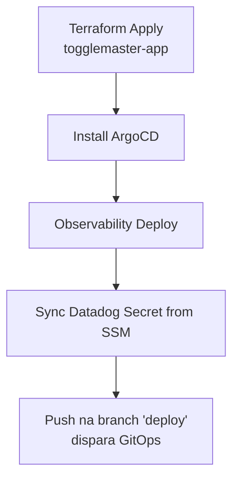
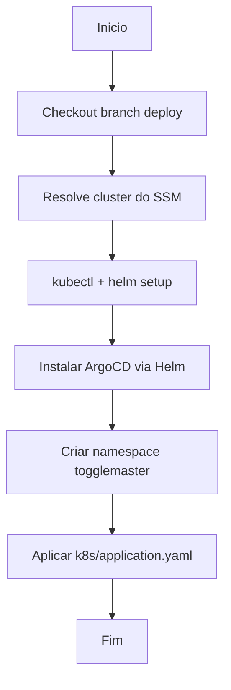
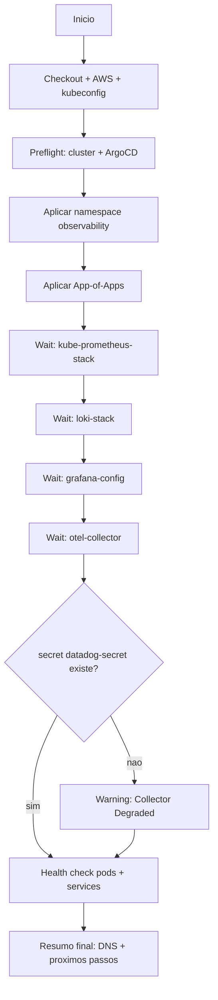
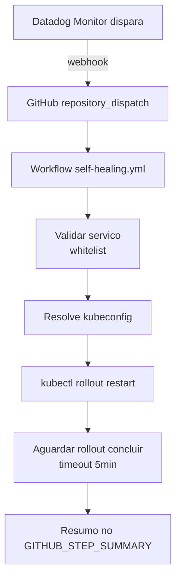

# Workflows de GitOps — togglemaster-deploy

Este repositório contém os workflows que gerenciam o ciclo de vida do
cluster EKS e dos componentes aplicados via ArgoCD.

Cada workflow tem **responsabilidade única e pode ser disparado isoladamente**,
exceto o `GitOps` que roda automaticamente a cada push na branch `deploy`.

---

## Visão geral dos workflows

| Workflow | Arquivo | Trigger | Papel | Bloco Fase 4 |
|---|---|---|---|---|
| **Install ArgoCD** | `argocd-install.yml` | manual | Instala o ArgoCD no cluster e aplica a Application dos microsserviços | — |
| **Observability Deploy** | `observability-deploy.yml` | manual | Sobe a stack de observabilidade (Prometheus, Grafana, Loki, OTel Collector) via App-of-Apps | 1 + 2 |
| **Sync Datadog Secret from SSM** | `datadog-secret-sync.yml` | manual | Cria o Secret `datadog-secret` no namespace `observability` a partir do SSM | 2 |
| **GitOps** | `gitops.yml` | push em `deploy` ou manual | Cria/atualiza o `togglemaster-config` ConfigMap, aplica db-init jobs, dá rollout restart nos deployments | 3 |
| **Alerts Deploy** | `alerts-deploy.yml` | manual | Aplica o Monitor do Datadog (`alerts/datadog/*.json`) via API — create/update idempotente | 4 |
| **Self-Healing Rollout** | `self-healing.yml` | `repository_dispatch` (Datadog) ou manual | Executa `kubectl rollout restart` no serviço afetado em resposta ao alerta | 4 |
| **Sync Kubernetes Secrets from SSM** | `secrets-sync.yml` | `workflow_call` | Reutilizável, chamado pelo `GitOps` para sincronizar secrets de banco/redis | — |

---

## Ordem recomendada em um deploy do zero



1. **Infra**: `Terraform Apply` no `togglemaster-app` cria EKS, RDS, Redis, SQS, DynamoDB, ECR.
2. **ArgoCD**: `Install ArgoCD` instala o controlador e cria a Application principal dos microsserviços.
3. **Observabilidade**: `Observability Deploy` sobe toda a stack de monitoramento (ver `docs/observability.md`).
4. **Datadog**: `Sync Datadog Secret from SSM` cria o secret que o OTel Collector precisa para exportar ao Datadog.
5. **GitOps**: um push na branch `deploy` (ou execução manual) atualiza o ConfigMap da aplicação e dá rollout nos microsserviços.
6. **Alertas**: `Alerts Deploy` cria o Monitor do Datadog (ver `docs/alerting.md`).
7. **Self-Healing**: configurado uma vez pelo painel do Datadog (webhook → `self-healing.yml`); roda automaticamente quando o monitor dispara.

---

## Install ArgoCD (`argocd-install.yml`)

### Papel

Instala o ArgoCD no cluster via Helm e aplica a `Application` que
representa o conjunto principal dos microsserviços
(`k8s/application.yaml`).

**Não aplica mais a stack de observabilidade** — isso agora é feito pelo
workflow `Observability Deploy`, separado para permitir re-execução
isolada e feedback granular.

### Diagrama



### Trigger

Manual: Actions → **Install ArgoCD** → Run workflow → branch `deploy`.

---

## Observability Deploy (`observability-deploy.yml`)

### Papel

Deploy independente da stack de observabilidade:

- **kube-prometheus-stack** (Prometheus + Grafana)
- **loki-stack** (Loki + Promtail)
- **opentelemetry-collector** (Collector contrib)
- **grafana-config** (datasource Loki + dashboard customizado)

Steps granulares permitem identificar exatamente onde algo falhou
(aplicação do App-of-Apps, sync de uma Application específica, health check de pods).

### Diagrama



### Trigger

Manual: Actions → **Observability Deploy** → Run workflow → branch `deploy`.

### Pré-requisito

ArgoCD instalado (ou seja, `Install ArgoCD` já rodou).

### Documentação detalhada

Ver `docs/observability.md` — arquitetura, componentes, troubleshooting.

---

## Sync Datadog Secret from SSM (`datadog-secret-sync.yml`)

### Papel

Lê os parâmetros `/togglemaster/prod/datadog/api-key` e
`/togglemaster/prod/datadog/site` do AWS SSM e cria/atualiza o Secret
`datadog-secret` no namespace `observability`.

### Trigger

Manual: Actions → **Sync Datadog Secret from SSM** → Run workflow.

### Pré-requisitos

- Namespace `observability` já criado (vem do `Observability Deploy`).
- Parâmetros SSM criados:
  ```bash
  aws ssm put-parameter --name "/togglemaster/prod/datadog/api-key" \
    --type SecureString --value "<SUA_API_KEY>" --overwrite
  aws ssm put-parameter --name "/togglemaster/prod/datadog/site" \
    --type String --value "datadoghq.com" --overwrite
  ```

---

## GitOps (`gitops.yml`)

### Papel

Workflow principal de atualização contínua. É disparado automaticamente
a cada push na branch `deploy` (ex: pelos workflows docker-pipeline do
`togglemaster-app`) ou pode ser rodado manualmente.

Executa, em cascata:

1. **Secrets** (via `secrets-sync.yml`): cria secrets de banco/redis/master-key no namespace `togglemaster` a partir do SSM.
2. **ConfigMap**: cria/atualiza o `togglemaster-config` com endpoints reais (RDS, Redis, SQS, DynamoDB) **e as envs OTEL_*** (`OTEL_EXPORTER_OTLP_ENDPOINT`, `OTEL_EXPORTER_OTLP_PROTOCOL`, `OTEL_RESOURCE_ATTRIBUTES`).
3. **Rollout restart** dos 5 deployments para pegar as novas envs.
4. **DB init jobs**: aplica os Jobs de inicialização dos bancos.

### Trigger

- Automático: `push` na branch `deploy`.
- Manual: Actions → **GitOps** → Run workflow.

---

## Sync Kubernetes Secrets from SSM (`secrets-sync.yml`)

### Papel

Workflow reutilizável (`workflow_call`), chamado pelo `GitOps`. Lê o SSM
e cria/atualiza os Secrets de aplicação no namespace `togglemaster`:

- `db-auth-secret`, `db-flag-secret`, `db-targeting-secret` (credenciais Postgres por serviço)
- `redis-secret`
- `togglemaster-secrets` (combinado com todas as credenciais + MASTER_KEY + SERVICE_API_KEY)

### Trigger

Apenas via `workflow_call`. Não é disparado manualmente.

---

---

## Alerts Deploy (`alerts-deploy.yml`)

### Papel

Aplica (cria ou atualiza) o Monitor do Datadog a partir do JSON versionado
em `alerts/datadog/`. Operação idempotente: busca o monitor pelo campo
`name`, PUT se existir e POST se não.

### Trigger

Manual: Actions → **Alerts Deploy** → Run workflow → branch `deploy`.

### Pré-requisitos

- Datadog API Key e App Key no SSM.
- Microsserviços instrumentados (Bloco 3) enviando traces ao Datadog APM.
- Documentação detalhada: `docs/alerting.md`.

---

## Self-Healing Rollout (`self-healing.yml`)

### Papel

Executa `kubectl rollout restart` no deployment do serviço afetado,
disparado por webhook do Datadog quando o Monitor entra em `alert`.

Também pode ser executado manualmente para testes.

### Diagrama



### Trigger

- Automático: `repository_dispatch` com `event_type: datadog-alert` (configurado no painel do Datadog como webhook).
- Manual: Actions → **Self-Healing Rollout** → Run workflow → selecionar o serviço.

### Segurança

- Whitelist dos 5 microsserviços conhecidos (não aceita nomes arbitrários).
- Namespace fixo `togglemaster`.
- Nenhuma credencial trafegada no payload do webhook (só o nome do serviço).

---

## Observações

- Todos os workflows manuais usam `workflow_dispatch` e podem ser rodados pela aba Actions do GitHub.
- Todos usam `AWS_SESSION_TOKEN` por causa das credenciais temporárias do AWS Academy — garanta que os secrets do repositório estejam atualizados a cada nova sessão.
- Os workflows são idempotentes: podem ser re-executados sem efeitos colaterais destrutivos.
