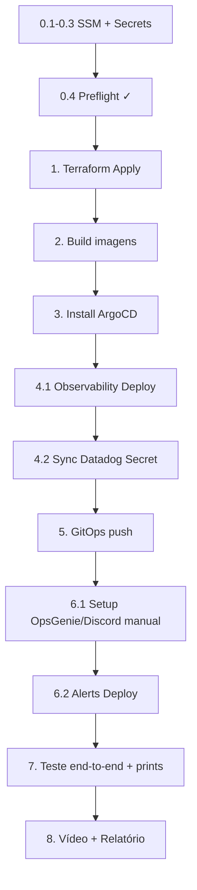

# Guia de Deploy — do zero ao vídeo da entrega

Checklist linear com comandos literais. Siga **na ordem**. Se algo falhar,
veja [`TROUBLESHOOTING.md`](./TROUBLESHOOTING.md).

> **Dica**: imprima essa página ou abra em outra aba. Marque cada passo com
> `[x]` conforme avança.

---

## Pré-requisitos (uma vez, fora do projeto)

- [ ] Conta **AWS Academy** com Learner Lab ativo.
- [ ] Conta **Datadog** (plano gratuito for education).
- [ ] Conta **OpsGenie** (plano free, 5 usuários).
- [ ] Servidor **Discord** com um canal `#alerts`.
- [ ] AWS CLI, kubectl, helm, jq instalados localmente.

---

## Fase 0 — Setup inicial (uma vez por sessão AWS Academy)

### 0.1 Credenciais AWS no `~/.aws/credentials`

Pegue as credenciais do AWS Academy e cole em `~/.aws/credentials` (seção `[default]`). Elas duram ~4h.

### 0.2 Secrets do GitHub

Nos repos **`togglemaster-app`** e **`togglemaster-deploy`**:

Settings → Secrets and variables → Actions → New repository secret

Crie em cada repo:

| Nome | Valor |
|---|---|
| `AWS_ACCESS_KEY_ID` | da AWS Academy |
| `AWS_SECRET_ACCESS_KEY` | da AWS Academy |
| `AWS_SESSION_TOKEN` | da AWS Academy |
| `AWS_REGION` | `us-east-1` |
| `DB_USERNAME` | ex: `postgres` (só no `togglemaster-app`) |
| `TERRAFORM_STATE_BUCKET` | nome do bucket S3 que armazena o state (só no `togglemaster-app`) |
| `PERSONAL_ACCESS_TOKEN` | PAT do GitHub com escopo `repo` (só no `togglemaster-app`) |

### 0.3 Parâmetros no AWS SSM

Rode no terminal (adapte os valores):

```bash
# ------- Base (necessario para subir infra e microsservicos) -------

# Nome do cluster EKS que o Terraform vai criar
aws ssm put-parameter --name "/togglemaster/prod/cluster-name" \
  --type String --value "togglemaster-eks" --overwrite

# Credenciais do Postgres por serviço (JSON com username + password)
for svc in auth flag targeting; do
  aws ssm put-parameter --name "/togglemaster/prod/$svc/credentials" \
    --type SecureString \
    --value '{"username":"postgres","password":"<ESCOLHA_UMA_SENHA>"}' \
    --overwrite
done

# Credencial do Redis (JSON com password)
aws ssm put-parameter --name "/togglemaster/prod/redis/credentials" \
  --type SecureString \
  --value '{"password":"<ESCOLHA_UMA_SENHA>"}' \
  --overwrite

# ------- Datadog (Blocos 2 e 4) -------

# API Key: Datadog UI → Organization Settings → API Keys → New Key
aws ssm put-parameter --name "/togglemaster/prod/datadog/api-key" \
  --type SecureString --value "<DD_API_KEY>" --overwrite

# App Key: Datadog UI → Organization Settings → Application Keys → New Key
aws ssm put-parameter --name "/togglemaster/prod/datadog/app-key" \
  --type SecureString --value "<DD_APP_KEY>" --overwrite

# Site (opcional): default datadoghq.com. Se sua conta for us5, eu, etc, ajuste.
aws ssm put-parameter --name "/togglemaster/prod/datadog/site" \
  --type String --value "datadoghq.com" --overwrite
```

### 0.4 Preflight Check (confere se tudo está no lugar)

Rode o workflow:

**`togglemaster-deploy`** → Actions → **Preflight Check** → Run workflow → branch `deploy`

Se der verde ✅, prossiga. Se der ❌, veja o que falta e volte no 0.3.

---

## Fase 1 — Infraestrutura (Terraform)

### 1.1 Rodar o Terraform Apply

**`togglemaster-app`** → Actions → **Terraform Apply** → Run workflow → branch `main`

Isso provisiona (em cascata):
- KMS + SSM customizations
- RDS (3 instâncias Postgres) + ElastiCache Redis + DynamoDB + SQS
- ECR (5 repositórios)
- EKS + Node Group
- Security Groups

Duração típica: **15 a 25 minutos**.

### 1.2 Validar

```bash
# Cluster EKS criado?
aws eks describe-cluster --name togglemaster-eks \
  --query 'cluster.{Name:name,Status:status,Version:version}'

# ECR com os 5 repos?
aws ecr describe-repositories \
  --query 'repositories[].repositoryName' --output table
```

---

## Fase 2 — Imagens dos microsserviços no ECR

Nessa fase, você faz **build + push** das imagens dos 5 serviços no ECR.

### 2.1 Disparar os workflows

Opção **A** (recomendado): faz um commit vazio em cada serviço no `togglemaster-app`
(gatilho natural dos workflows).

```bash
cd togglemaster-app
for svc in auth flag targeting evaluation analytics; do
  git commit --allow-empty -m "chore(deploy): trigger build $svc-service"
done
git push origin main
```

Opção **B**: dispare manualmente cada workflow:
`togglemaster-app` → Actions → `auth-service` → Run workflow (etc).

### 2.2 Validar

```bash
# Imagens com SHA do commit em todos os 5 repos
for svc in auth flag targeting evaluation analytics; do
  echo "--- $svc ---"
  aws ecr describe-images \
    --repository-name togglemaster-$svc \
    --query 'imageDetails[].imageTags' --output text
done
```

---

## Fase 3 — ArgoCD + aplicação principal

### 3.1 Instalar o ArgoCD

**`togglemaster-deploy`** → Actions → **Install ArgoCD** → Run workflow → branch `deploy`

Isso faz:
- Helm `argo-cd` v7.8.0 no namespace `argocd` (modo LoadBalancer + insecure, com `ignoreDifferences` globais pra evitar `ComparisonError`).
- Aplica `k8s/application.yaml` — Application do ArgoCD que gerencia os 5 microsserviços.

Duração: ~5 min.

### 3.2 Validar

```bash
aws eks update-kubeconfig --region us-east-1 --name togglemaster-eks

kubectl get pods -n argocd              # todos Running
kubectl get applications -n argocd      # 'togglemaster' deve aparecer
```

---

## Fase 4 — Stack de observabilidade (Blocos 1 e 2)

### 4.1 Rodar o workflow

**`togglemaster-deploy`** → Actions → **Observability Deploy** → Run workflow → branch `deploy`

Esse workflow aplica o App-of-Apps da observabilidade e aguarda cada Application
sincronizar. **18 steps granulares** — se algo falhar, você vê exatamente em qual.

Duração: ~10 min (os Helm charts de Prometheus/Loki demoram).

### 4.2 Criar o Secret do Datadog

**`togglemaster-deploy`** → Actions → **Sync Datadog Secret from SSM** → Run workflow

Isso lê os parâmetros SSM do Datadog e cria o Secret `datadog-secret` no namespace
`observability`. **Sem esse secret, o OTel Collector fica em `CreateContainerConfigError`**.

### 4.3 Validar

```bash
# Applications sincronizadas
kubectl get applications -n argocd \
  -o custom-columns='NAME:.metadata.name,SYNC:.status.sync.status,HEALTH:.status.health.status'

# Pods de pé no namespace observability
kubectl get pods -n observability

# Grafana (abre no browser)
kubectl port-forward -n observability svc/kube-prometheus-stack-grafana 3000:80
# http://localhost:3000  —  user: admin  /  password: togglemaster
```

Dashboard "ToggleMaster - Visao Geral do Ecossistema" deve estar na lista.

---

## Fase 5 — Deploy dos microsserviços (Bloco 3)

### 5.1 Rodar o GitOps

Faça um commit vazio na branch `deploy` do `togglemaster-deploy`:

```bash
cd togglemaster-deploy
git checkout deploy
git commit --allow-empty -m "chore(deploy): trigger gitops"
git push origin deploy
```

Isso dispara o workflow **GitOps** que:
1. Cria `togglemaster-secrets`, `db-*-secret`, `redis-secret` no cluster (de SSM).
2. Cria/atualiza o ConfigMap `togglemaster-config` com endpoints reais **e as envs OTEL_*** (Bloco 3).
3. Aplica os db-init Jobs.
4. Faz `kubectl rollout restart` nos 5 deployments pra pegar as novas envs.

Duração: ~5 min.

### 5.2 Validar

```bash
# Pods dos microsserviços
kubectl get pods -n togglemaster

# ConfigMap tem as envs OTEL
kubectl get cm togglemaster-config -n togglemaster -o yaml | grep OTEL_

# Pod tem as envs OTEL
kubectl exec -n togglemaster deploy/auth-service -- env | grep OTEL_
```

Depois disso, abra o **Datadog APM → Services**: os 5 serviços devem aparecer. Pode levar alguns minutos até os primeiros traces chegarem.

---

## Fase 6 — Alertas, OpsGenie, Discord (Bloco 4)

### 6.1 Setup manual (uma vez, fora do GitHub)

Siga o passo a passo em [`docs/alerting.md`](./docs/alerting.md), passos **2 a 4**:

- [ ] OpsGenie: criar team `togglemaster` + integração Datadog.
- [ ] Discord: criar webhook do canal `#alerts` + integrar no OpsGenie.
- [ ] Datadog: criar webhook `togglemaster-self-healing` apontando pro
  `repository_dispatch` do GitHub Actions.

### 6.2 Aplicar o Monitor

**`togglemaster-deploy`** → Actions → **Alerts Deploy** → Run workflow

Esse workflow lê o payload JSON versionado em `alerts/datadog/monitor-5xx-auth.json`
e cria/atualiza o Monitor no Datadog via API.

### 6.3 Validar

- Datadog UI → **Monitors** → o monitor `[ToggleMaster] auth-service - taxa de erros 5xx > 5%` deve aparecer com status `OK` ou `No Data`.

---

## Fase 7 — Teste end-to-end (pro vídeo)

### 7.1 Gerar carga normal

Pegue o endpoint do Ingress:

```bash
INGRESS=$(kubectl get svc -n ingress-nginx ingress-nginx-controller \
  -o jsonpath='{.status.loadBalancer.ingress[0].hostname}')
echo "http://$INGRESS"
```

Faça algumas chamadas de evaluate (depende dos dados — ajuste `flag_name`):

```bash
for i in {1..50}; do
  curl -s "http://$INGRESS/evaluate?user_id=u$i&flag_name=test-flag"
done
```

Observe no Datadog APM → **Service Map**: os 5 serviços devem aparecer
conectados por setas (`evaluation` → `auth`, `flag`, `targeting`).

### 7.2 Causar incidente proposital

Derruba o `auth-service` pra forçar erros no evaluation:

```bash
kubectl scale deployment auth-service -n togglemaster --replicas=0
```

Dispare carga pelo `/evaluate`:

```bash
for i in {1..500}; do
  curl -s "http://$INGRESS/evaluate?user_id=u$i&flag_name=test-flag" &
done
wait
```

Dentro de **~5 min**, observe:

1. **Datadog Monitor** entra em `Alert` (status vermelho).
2. **OpsGenie** abre um incidente (visível no dashboard do OpsGenie).
3. **Discord** canal `#alerts` recebe notificação (via integração OpsGenie).
4. **GitHub Actions** → `togglemaster-deploy` → workflow **Self-Healing Rollout** roda.
5. O workflow executa `kubectl rollout restart deployment/auth-service`.

### 7.3 Prints obrigatórios (relatório PDF)

Capture durante o passo 7.2:

- [ ] Dashboard do Grafana aberto, dados fluindo.
- [ ] Datadog APM → Service Map com os 5 serviços.
- [ ] Datadog APM → Trace distribuído de uma chamada `/evaluate`.
- [ ] Discord `#alerts` com a notificação do incidente.
- [ ] GitHub Actions → run do **Self-Healing Rollout** → log do `kubectl rollout restart`.

### 7.4 Restaurar

```bash
kubectl scale deployment auth-service -n togglemaster --replicas=1
```

---

## Fase 8 — Entrega

- [ ] Gravar vídeo de **até 25 min** cobrindo as 4 seções do PDF.
- [ ] Montar relatório PDF com os prints acima + justificativa técnica
  (texto pronto em [`docs/alerting.md`](./docs/alerting.md) → seção "Justificativa das escolhas").
- [ ] Submeter.

---

## Resumo visual



Se qualquer passo falhar: [`TROUBLESHOOTING.md`](./TROUBLESHOOTING.md).
