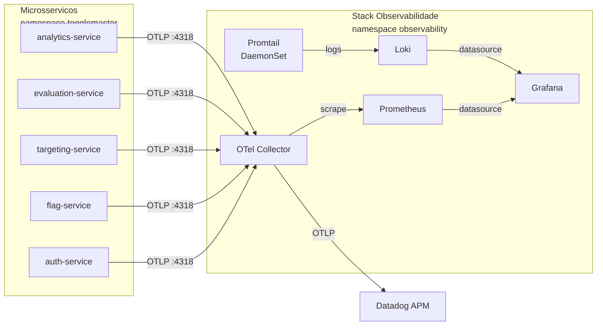
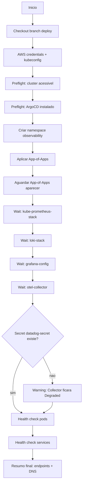
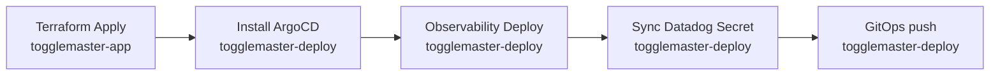

# Stack de Observabilidade (Fase 4 — Blocos 1 e 2)

Documentação da stack de observabilidade do ToggleMaster. Esta stack é
provisionada por um **workflow dedicado** (`Observability Deploy`), separado
do workflow de instalação do ArgoCD, para permitir re-execução isolada e
feedback de progresso detalhado.

---

## Arquitetura



Fluxo em palavras:

- Os **microsserviços** enviam traces, métricas e logs estruturados em OTLP para o **OTel Collector**.
- O **OTel Collector** exporta: métricas para o **Prometheus** (via endpoint `/metrics` scrape) e traces + logs para o **Datadog APM**.
- O **Promtail** (DaemonSet) coleta logs de container (stdout/stderr) de todos os pods e envia para o **Loki**.
- O **Grafana** consome Prometheus e Loki como datasources e serve o dashboard customizado.

---

## Componentes

| Componente | Fonte | Versão | Função |
|---|---|---|---|
| **kube-prometheus-stack** | Helm `prometheus-community` | 65.1.1 | Prometheus + Grafana (chart agregado) |
| **loki-stack** | Helm `grafana` | 2.10.2 | Loki + Promtail |
| **opentelemetry-collector** | Helm `open-telemetry` | 0.173.1 | Collector contrib (inclui exporter Datadog) |
| **grafana-config** | manifests locais | — | ConfigMaps do datasource Loki + dashboard custom |

Todos rodam no namespace **`observability`**.

---

## Arquitetura GitOps (App of Apps)

Toda a stack é gerenciada pelo ArgoCD via o padrão **App of Apps**: um
`Application` pai (`observability`) aponta para a pasta
`k8s/observability/applications/`, e cada arquivo YAML lá dentro é uma
`Application` filha que o ArgoCD descobre e sincroniza automaticamente.

```text
k8s/observability/
├── namespace.yaml                      # Namespace observability
├── app-of-apps.yaml                    # Application pai
├── applications/
│   ├── kube-prometheus-stack.yaml      # Helm chart via ArgoCD
│   ├── loki-stack.yaml                 # Helm chart via ArgoCD
│   ├── otel-collector.yaml             # Helm chart via ArgoCD
│   └── grafana-config.yaml             # Aplica pasta grafana/ via kustomize
├── grafana/
│   ├── kustomization.yaml
│   ├── datasource-loki.yaml            # ConfigMap (sidecar grafana auto-importa)
│   └── dashboard-togglemaster.yaml     # ConfigMap (sidecar grafana auto-importa)
├── README.md                           # README tecnico da pasta
└── docs/observability.md               # <- este documento
```

Não há renderização local de Helm charts: o ArgoCD resolve o Helm na hora
da sincronização, apontando para os repositórios oficiais da comunidade.

---

## Pipeline de Deploy

### Workflow: `Observability Deploy`

**Arquivo:** `togglemaster-deploy/.github/workflows/observability-deploy.yml`

**Trigger:** manual (`workflow_dispatch`)

**Pré-requisito:** ArgoCD já instalado no cluster (via workflow `Install ArgoCD`).

### Diagrama do fluxo



### Steps granulares

Cada step aparece como linha separada no painel do GitHub Actions,
permitindo identificar exatamente onde um deploy falhou:

| Step | Papel |
|---|---|
| `Preflight / cluster acessivel` | Garante que o kubectl responde |
| `Preflight / ArgoCD instalado` | Verifica que `argocd-server` está `Available` |
| `Namespace observability` | Aplica `k8s/observability/namespace.yaml` |
| `Aplicar App-of-Apps` | Aplica o Application pai com `envsubst` do `REPO_URL` |
| `Aguardar App-of-Apps aparecer` | Pool por até 150s até o CRD aparecer no ArgoCD |
| `Aguardar kube-prometheus-stack` | Wait até `sync=Synced` + `health=Healthy` |
| `Aguardar loki-stack` | idem |
| `Aguardar grafana-config` | idem |
| `Aguardar otel-collector` | idem (não falha se Degraded — depende do secret) |
| `Checar secret datadog-secret` | Warning claro se faltar o secret |
| `Health check / pods` | Lista pods, aponta não-Running |
| `Health check / services` | Lista services expostos |
| `Resumo final` | DNS internos, URL do Grafana, próximos passos |

### Inputs opcionais

| Input | Default | Função |
|---|---|---|
| `wait_timeout_seconds` | `600` | Timeout por Application ao esperar sync |
| `skip_health_checks` | `false` | Pula health checks dos pods |

---

## Como fazer deploy

### Ordem recomendada



1. **`Terraform Apply`** (`togglemaster-app`) — provisiona EKS, RDS, Redis, SQS, DynamoDB, ECR.
2. **`Install ArgoCD`** (`togglemaster-deploy`) — instala ArgoCD + aplica a Application principal dos microsserviços.
3. **`Observability Deploy`** (`togglemaster-deploy`) — **este workflow**, sobe toda a stack.
4. **`Sync Datadog Secret from SSM`** (`togglemaster-deploy`) — cria o secret `datadog-secret` lido pelo OTel Collector.
5. Push na branch `deploy` dispara o **`GitOps`**, que atualiza o `togglemaster-config` ConfigMap (incluindo as envs `OTEL_*` do Bloco 3) e dá rollout restart nos microsserviços.

---

## Dashboard customizado

Localização: `k8s/observability/grafana/dashboard-togglemaster.yaml`

É um ConfigMap com o label `grafana_dashboard: "1"`. O sidecar do Grafana
monitora ConfigMaps com esse label em todos os namespaces e importa
automaticamente qualquer dashboard que apareça.

**Painéis incluídos** (atende os requisitos do PDF):

1. **Uso de recursos do cluster** — CPU e memória por pod no namespace `togglemaster`.
2. **Taxa de requisições dos microsserviços** — req/s por serviço (baseado em métricas OTel) e taxa de erros 5xx.
3. **Logs em tempo real** — painel Loki filtrado por `namespace="togglemaster"`.

---

## Pré-requisito: Secret do Datadog

O OTel Collector precisa da `DD_API_KEY` para exportar traces/métricas/logs
ao Datadog. Esse secret **não é** gerenciado por este workflow — ele vem
do workflow dedicado `Sync Datadog Secret from SSM`.

### Parâmetros no AWS SSM

| Parameter | Tipo | Obrigatório |
|---|---|---|
| `/togglemaster/prod/datadog/api-key` | SecureString | sim |
| `/togglemaster/prod/datadog/site` | String | não (default `datadoghq.com`) |

Criação:

```bash
aws ssm put-parameter \
  --name "/togglemaster/prod/datadog/api-key" \
  --type SecureString \
  --value "<SUA_API_KEY>" --overwrite

aws ssm put-parameter \
  --name "/togglemaster/prod/datadog/site" \
  --type String \
  --value "datadoghq.com" --overwrite
```

Rode em seguida o workflow **`Sync Datadog Secret from SSM`** — ele lê o
SSM e cria o Secret `datadog-secret` no namespace `observability`.

> O Collector sobe mesmo sem o secret, mas fica em `CreateContainerConfigError`
> até que o secret apareça. Ao criar o secret, o pod se recupera sozinho (self-heal).

---

## Como validar

### Após o workflow passar

```bash
# Applications sincronizadas
kubectl get applications -n argocd

# Pods de pé
kubectl get pods -n observability
```

### Grafana

```bash
kubectl port-forward -n observability svc/kube-prometheus-stack-grafana 3000:80
# Abrir http://localhost:3000
# user: admin  /  password: togglemaster
```

O dashboard "ToggleMaster - Visao Geral do Ecossistema" deve aparecer na lista.

### Prometheus (opcional)

```bash
kubectl port-forward -n observability svc/kube-prometheus-stack-prometheus 9090:9090
# http://localhost:9090 — procurar por "serviceMonitor/otel-collector-opentelemetry-collector"
```

### Smoke test do OTel Collector

Após o `datadog-secret` ser criado e os microsserviços estarem instrumentados
(Bloco 3):

```bash
# Dentro do cluster, verificar que o collector esta recebendo OTLP
kubectl logs -n observability deploy/otel-collector-opentelemetry-collector | grep -i "export"
```

No Datadog, abrir **APM > Service Map** — devem aparecer os 5 microsserviços
conectados.

---

## Troubleshooting

### Application `otel-collector` fica `Degraded`

Causa quase sempre é o secret `datadog-secret` não existir no namespace
`observability`.

```bash
kubectl get pods -n observability -l app.kubernetes.io/name=opentelemetry-collector
# Esperado quando falta o secret: CreateContainerConfigError
```

Solução: rodar o workflow `Sync Datadog Secret from SSM`.

### Application fica `OutOfSync` indefinidamente

Checar o status detalhado:

```bash
kubectl describe application <nome> -n argocd
```

Causas comuns:
- Repo URL errado (nossa Application `grafana-config` referencia explicitamente `tech-tm/togglemaster-deploy`; se o fork for outro, ajustar em `applications/grafana-config.yaml`).
- Branch alvo errada (todas apontam para `deploy`).

### Dashboard não aparece no Grafana

O sidecar leva ~60s pra importar. Se não aparecer depois disso:

```bash
# Confirmar que o ConfigMap tem o label correto
kubectl get cm grafana-dashboard-togglemaster -n observability \
  -o jsonpath='{.metadata.labels}'
# Esperado: {"grafana_dashboard":"1"}

# Olhar os logs do sidecar
kubectl logs -n observability \
  -l app.kubernetes.io/name=grafana -c grafana-sc-dashboard --tail=50
```

### Collector não recebe telemetria dos microsserviços

Verificar as envs OTEL_* nos pods da aplicação (Bloco 3):

```bash
kubectl exec -n togglemaster deploy/auth-service -- env | grep OTEL_
```

Esperado:
```text
OTEL_SERVICE_NAME=auth-service
OTEL_EXPORTER_OTLP_ENDPOINT=http://otel-collector-opentelemetry-collector.observability.svc.cluster.local:4318
OTEL_EXPORTER_OTLP_PROTOCOL=http/protobuf
OTEL_RESOURCE_ATTRIBUTES=deployment.environment=prod
```

Se faltarem, rode o workflow **`GitOps`** (ou faça um push vazio na branch `deploy`)
para forçar a atualização do `togglemaster-config` ConfigMap e o rollout.

---

## Observações para o AWS Academy (EKS / LabRole)

- `kubeControllerManager`, `kubeScheduler`, `kubeEtcd` e `kubeProxy` estão **desativados** nos values do `kube-prometheus-stack` — o control plane do EKS é gerenciado e não permite scraping, então mantê-los ativos geraria alertas falsos de "target down".
- Loki roda em modo single-binary com storage **efêmero** (`persistence: false`). Para produção, usar object storage S3.
- OTel Collector usa a imagem `opentelemetry-collector-contrib` porque só ela inclui o exporter `datadog`. A imagem "core" não funcionaria.
