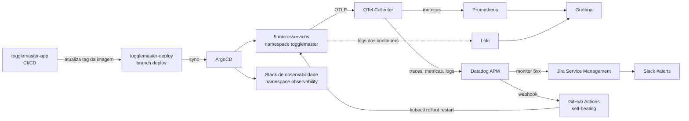

# ToggleMaster – GitOps & Observabilidade

[](https://github.com/tech-tm/togglemaster-deploy/actions)
[](https://argo-cd.readthedocs.io/)
[](https://kustomize.io/)
[](https://opentelemetry.io/)
[](https://www.datadoghq.com/)
[](LICENSE)

---

Repositório **GitOps** do projeto **ToggleMaster** (Tech Challenge Fase 4 — FIAP Pós-Tech DevOps).
Ele concentra tudo o que roda no cluster **EKS** e a configuração da observabilidade:

- **Manifests dos 5 microsserviços** (Kustomize), sincronizados pelo **ArgoCD**.
- **Stack de observabilidade**: Prometheus, Grafana, Loki, OpenTelemetry Collector e metrics-server.
- **Alertas como código**: monitores e webhook do **Datadog** em Terraform.
- **Resposta a incidentes**: Jira Service Management, Slack e **self-healing** via GitHub Actions.

O código dos microsserviços e a infraestrutura AWS (Terraform) ficam no repositório
[`togglemaster-app`](https://github.com/tech-tm/togglemaster-app).

> Tudo o que está em `k8s/` é aplicado pelo ArgoCD. A branch de trabalho é a **`deploy`**.

---

## Arquitetura



---

## Estrutura do repositório

```plaintext
.
├── k8s/
│   ├── application.yaml        # Application ArgoCD dos microsservicos
│   ├── argocd/                 # Values do Helm do ArgoCD
│   ├── base/                   # Manifests base
│   │   ├── cluster-config/     # aws-auth
│   │   ├── ingress-controller/ # ingress-nginx
│   │   ├── ingress.yaml        # Rotas /auth, /flag, /targeting, /evaluation, /analytics
│   │   ├── jobs/               # Jobs de inicializacao dos bancos (sql/)
│   │   └── services/           # auth, flag, targeting, evaluation, analytics (+ HPAs)
│   ├── overlays/prod/          # Overlay de producao: replicas e tags de imagem
│   └── observability/
│       ├── app-of-apps.yaml    # Application pai da observabilidade
│       ├── applications/       # Uma Application por componente (somente Applications!)
│       └── grafana/            # Datasource Loki, dashboard e ServiceMonitor
├── terraform/                  # Monitores e webhook do Datadog (alertas como codigo)
├── docs/                       # Documentacao (deploy, testes, troubleshooting, ...)
├── .github/workflows/          # Pipelines (ArgoCD, observabilidade, GitOps, Datadog, self-healing)
├── STATUS.md                   # Checklist de retomada do ambiente
└── LICENSE
```

---

## Fluxo GitOps

1. Um push no `togglemaster-app` dispara o pipeline do serviço (testes, lint e scan de segurança).
2. O pipeline **Docker** constrói a imagem, publica no **ECR** e atualiza a tag em
   `k8s/overlays/prod/kustomization.yaml` (branch `deploy` deste repositório).
3. O **ArgoCD** detecta a mudança e sincroniza os manifests.
4. O Kubernetes faz o rollout da nova versão.

| Serviço | Linguagem | Pasta | Rota no Ingress |
|---|---|---|---|
| Auth | Go | `k8s/base/services/auth` | `/auth/*` |
| Flag | Python | `k8s/base/services/flag` | `/flag/*` |
| Targeting | Python | `k8s/base/services/targeting` | `/targeting/*` |
| Evaluation | Go | `k8s/base/services/evaluation` | `/evaluation/*` |
| Analytics | Python | `k8s/base/services/analytics` | `/analytics/*` |

---

## Observabilidade

A stack sobe pelo workflow **Observability Deploy**, que aplica o App-of-Apps
`k8s/observability/app-of-apps.yaml`. Cada componente é uma Application do ArgoCD.

| Componente | Função | Onde fica |
|---|---|---|
| **Prometheus + Grafana** | Métricas do cluster e dashboard "ToggleMaster — Visão Geral do Ecossistema" | `k8s/observability/applications/kube-prometheus-stack.yaml` |
| **Loki + Promtail** | Logs centralizados de todos os containers | `k8s/observability/applications/loki-stack.yaml` |
| **OpenTelemetry Collector** | Recebe traces, métricas e logs (OTLP) e envia ao Prometheus e ao Datadog | `k8s/observability/applications/otel-collector.yaml` |
| **metrics-server** | API de métricas usada pelos HPAs | `k8s/observability/applications/metrics-server.yaml` |
| **Datadog APM** | Traces distribuídos, Service Map e monitores de 5xx (um por serviço) | `terraform/` |
| **JSM + Slack + self-healing** | Incidente, notificação ChatOps e `kubectl rollout restart` automático | `docs/alerting.md` |

### Acesso rápido

```bash
# Grafana (user: admin / password: togglemaster)
kubectl port-forward -n observability svc/kube-prometheus-stack-grafana 3000:80
# http://localhost:3000

# Status das Applications de observabilidade
kubectl get applications -n argocd \
  -o custom-columns='NAME:.metadata.name,SYNC:.status.sync.status,HEALTH:.status.health.status'
```

No **Datadog**: APM → Service Map (dependências entre os serviços) e Monitors →
`[ToggleMaster] <serviço> - taxa de erros 5xx`.

Detalhes em [`docs/observability.md`](docs/observability.md) e [`docs/alerting.md`](docs/alerting.md).

---

## Workflows

Todos são disparados manualmente (Actions → Run workflow), exceto o GitOps e o self-healing.

| Ordem | Workflow | O que faz |
|---|---|---|
| 0 | **Preflight Check** | Confere credenciais, SSM e pré-requisitos |
| 1 | **Install ArgoCD** | Instala o ArgoCD e a Application dos microsserviços |
| 2 | **Observability Deploy** | Sobe a stack de observabilidade |
| 3 | **Sync Datadog Secret from SSM** | Cria o secret usado pelo OTel Collector |
| 4 | **GitOps** | Secrets, ConfigMap, jobs de banco e rollout (dispara no push na `deploy`) |
| 5 | **Datadog Terraform — Apply** | Cria os monitores e o webhook no Datadog |
| — | **Self-Healing Rollout** | Disparado pelo webhook do Datadog quando um monitor alerta |
| — | **Datadog Terraform — Destroy** | Remove monitores e webhook (pede confirmação) |

Detalhes em [`.github/workflows/README.md`](.github/workflows/README.md).

---

## Documentação

| Documento | Conteúdo |
|---|---|
| [`docs/DEPLOY.md`](docs/DEPLOY.md) | Passo a passo completo do deploy, da Fase 0 à entrega |
| [`docs/TESTES.md`](docs/TESTES.md) | Testes de validação e smoke test |
| [`docs/TROUBLESHOOTING.md`](docs/TROUBLESHOOTING.md) | Problemas conhecidos e como resolver |
| [`docs/observability.md`](docs/observability.md) | Arquitetura da observabilidade |
| [`docs/alerting.md`](docs/alerting.md) | Alertas, JSM, Slack e self-healing |
| [`terraform/README.md`](terraform/README.md) | Camada Terraform do Datadog |
| [`STATUS.md`](STATUS.md) | Checklist para retomar o ambiente |

---

## Segredos

Nenhum segredo é versionado. Credenciais de banco, Redis, Datadog e o PAT do GitHub ficam no
**AWS SSM Parameter Store** e viram **Secrets do Kubernetes** pelos workflows. Veja a
seção 0.3 do [`docs/DEPLOY.md`](docs/DEPLOY.md).

---

## Acesso ao ArgoCD

```bash
aws eks update-kubeconfig --region us-east-1 --name togglemaster-eks

# URL do Load Balancer
kubectl get svc argocd-server -n argocd -o jsonpath="{.status.loadBalancer.ingress[0].hostname}"

# Senha inicial do usuário admin
kubectl -n argocd get secret argocd-initial-admin-secret -o jsonpath="{.data.password}" | base64 -d
```

---

## Validar os manifests localmente

```bash
kustomize build k8s/overlays/prod
kustomize build k8s/overlays/prod | kubectl apply --dry-run=client -f -
```

---

## Licença

Distribuído sob a licença MIT. Veja [`LICENSE`](LICENSE).
